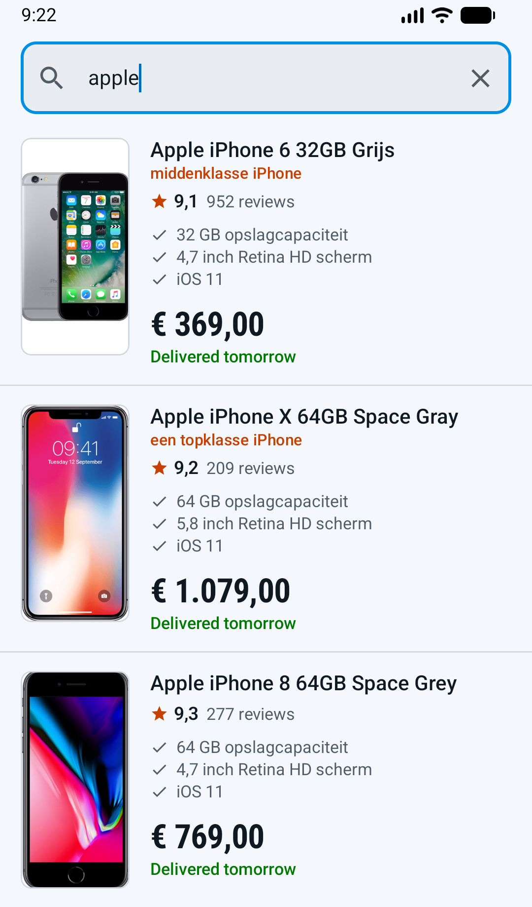
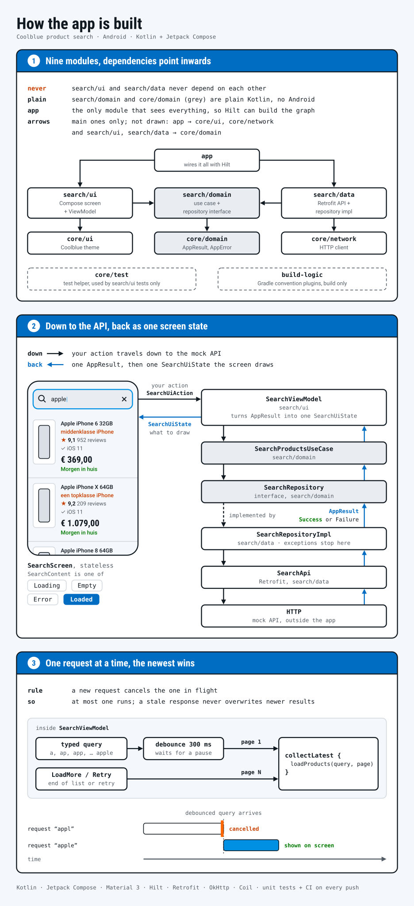

# Coolblue product search

[](https://github.com/Kmozcan1/coolblue-android-assignment/actions/workflows/ci.yml)

An Android app for the Coolblue mobile assignment: type a query, scroll through the results.
Kotlin, Jetpack Compose, one screen.



- **The mock API ignores the search term.** The app shows what it returns; a version that searches
  in the app is on the [`in-app-search`](https://github.com/Kmozcan1/coolblue-android-assignment/tree/in-app-search) branch.
- **Only the newest request counts.** A slow, stale response never overwrites newer results.
- **Clean Architecture, MVVM, Hilt and Retrofit**, in nine modules to show how the project would grow.
- **46 unit tests**, written test-first. GitHub Actions runs them on every push.
- **Pair-programmed with Claude Code**, every design decision discussed first and every line reviewed.

From [Architecture](#architecture) down is optional detail. Engineers: start with its
diagram, then [Trade-offs](#trade-offs).

## Run it

Open the project in Android Studio (latest stable) and run `app`, or from the command line:

```bash
./gradlew assembleDebug test
```

Requires Android 8.0 (API 26) or newer on the device and JDK 17 or newer to build. The app talks
to the assignment's mock API; its URL is a constant in `core/network`.

## What it does

- The app opens on the whole catalogue. Typing searches, debounced by 300 ms, and clearing the
  field brings the catalogue back.
- The query goes to the API with every page request and the list shows what comes back. The
  assignment's API is a mock that returns the same catalogue for every search term, so every
  query lists the same products. The [`in-app-search`](https://github.com/Kmozcan1/coolblue-android-assignment/tree/in-app-search) branch searches in the app
  instead: "ipad" shows the iPads and the Apple Pencil, "samsung" shows "No products found".
- Results come in pages of 24. Scrolling near the end loads the next page until the last one.
- Pulling the list down fetches it again.
- Dutch on a Dutch phone, English otherwise. The flag next to the search field switches, and
  prices, ratings and counts follow the words: "€ 1.079,00" in Dutch, "€1,079.00" in English.
- Each row shows the product image, name, review score and count, up to three USPs, a promo
  label, the price (with the old price struck through when it is higher than the current one)
  and the next-day delivery promise.
- Every error offers a way out: a message with Retry under the field when the first page fails,
  a footer row with Retry when a later page fails, a snackbar with Try again when a refresh fails.
  The last two keep the rows already on screen.
- Tapping a row opens the product in a bottom sheet: the full name, every USP, a larger photo.
- The query survives rotation and process death. After a restore the search runs again by itself.

## Architecture



<details>
<summary>The same in text: modules, data flow, one request pipeline</summary>

Multi-module Clean Architecture with MVVM and unidirectional data flow. One feature, `search`,
split into three layers, plus a few shared modules.

```
app             Application (also Coil's image loader), MainActivity, the theme wrapped around the one screen
build-logic     Gradle convention plugins, so each module's build file is about ten lines
core/domain     AppResult and AppError, the result contract every repository returns
core/network    OkHttp, kotlinx-serialization and Retrofit, provided through Hilt
core/ui         Material 3 theme in Coolblue colours
core/test       MainDispatcherRule, shared by ViewModel tests
search/domain   Product, ProductPage, SearchRepository, SearchProductsUseCase
search/data     Retrofit API, DTOs, DTO-to-domain mapper, SearchRepositoryImpl, Hilt bindings
search/ui       SearchViewModel, UiState, UiAction, composables, UI model and its mapper
```

Dependencies point inwards: `search/ui` and `search/data` both depend on `search/domain`,
never on each other, and `search/domain` depends only on `core/domain`. Both are plain Kotlin
modules with no Android dependency. `app` is the only module that sees everything, which is
what lets Hilt build the object graph.

### Data flow

```
SearchScreen ─onAction─▶ SearchViewModel ─▶ SearchProductsUseCase ─▶ SearchRepository (interface)
                                                                          │
                                                        SearchRepositoryImpl ─▶ SearchApi ─▶ HTTP
```

- The screen is stateless. It receives one `SearchUiState` and sends `SearchUiAction`s back.
  Nothing else crosses that boundary, so the screen can be previewed in every state without a
  ViewModel.
- `SearchUiState` holds the query and a sealed `SearchContent`: `Loading`, `Empty`, `Error` or
  `Loaded`. Exactly one is active, so there is no combination of booleans that can disagree
  with each other.
- Tapping a row opens the same product in a bottom sheet, nothing clipped, every USP. Which
  sheet is open is screen-local `rememberSaveable` state, not part of `SearchUiState`: it is
  transient chrome over a product the `Loaded` content already holds. A query change closes it,
  and so does a restore after process death, since the search starts over.
- `Loading` only shows when there are no rows to keep: a cold start, a restore after process
  death, Retry after an error, or a refinement from an empty result. Refining a query that has
  rows keeps them on screen under a thin progress bar, with `Loaded.isRefreshing` set, until the
  new rows replace them at the top; `LoadMore` is ignored meanwhile, since page 2 would belong to the new query.
  A pull to refresh sets the same flag for the rows' own query and shows the pull indicator instead.
  If it fails the rows stay, since they still answer the query, and `Loaded.refreshFailure` holds
  the reason until the snackbar has shown it.
- The repository returns `AppResult`: `Success` with data or `Failure` with an `AppError`.
  Exceptions stop at the data layer; the ViewModel only ever sees these two cases.

### One request pipeline

Every request the ViewModel makes goes through a single flow:

```kotlin
merge(query.debounce(300).map { 1 }, pageRequests)
    .collectLatest { page -> load(query.value, page) }
```

The debounced query asks for page 1. `Retry`, `LoadMore` and `Refresh` push a page number into
`pageRequests`. `collectLatest` cancels the previous load whenever a new request arrives, so at
most one request is ever in flight for the screen and a slow, stale response can never overwrite
a newer state. There are no job fields to cancel by hand.

</details>

## Libraries and why

| Library | Why |
|---|---|
| Retrofit 3 + OkHttp 5 | One `@GET` with two `@Query` parameters covers the whole API. The most widely known networking stack on Android. |
| kotlinx-serialization | JSON parsing with compiler-generated serializers, no reflection. Retrofit's own converter plugs it in. |
| Hilt | Dependency injection with compile-time checking. ViewModels get their use case, the repository gets its API, nothing is constructed by hand. |
| Coil 3 | Image loading for Compose. Shares the OkHttp client with Retrofit. |
| Compose + Material 3 | The UI toolkit the assignment asks for. |
| AppCompat | Only for the per-app language: it switches and remembers it on every Android version, where the platform API starts at Android 13. |
| JUnit 4, MockK, Truth, Turbine | Unit tests, mocking, readable assertions, Flow testing. |
| MockWebServer | Tests the repository against real HTTP responses, including the actual JSON the API returns. |

## Trade-offs

- **The app shows what the API returns.** The mock ignores the search term, so whether the app
  should search the catalogue itself is a product call. The `in-app-search` branch does, in
  [one commit on top of main](https://github.com/Kmozcan1/coolblue-android-assignment/compare/main...in-app-search) that touches only `search/domain` and this README. Main
  keeps the use case, though it is a single repository call, so turning in-app search on never
  touches the ViewModel.
- **Hand-rolled paging, not Paging 3.** Three pages of 24 don't need it. `ProductPage` maps
  straight onto a `PagingSource`, so the data side of a switch is small; the ViewModel and the
  list would trade their load-more state for `PagingData` and `LoadState`.
- **Nine modules for one screen.** More than the screen needs, but a second feature is three
  more modules and no edits to `search`.
- **Prices as integer cents.** The API's decimal euros are rounded to `Int` cents once, in the
  mapper, so the domain never does arithmetic on floats. The UI formats them in the app's language when it draws them.

## Tests

| Module | Test | Covers |
|---|---|---|
| search/domain | `ProductPageTest` | next page from page count |
| search/data | `ProductMapperTest` | DTO to domain, euros to cents, optional fields |
| search/data | `SearchRepositoryImplTest` | MockWebServer: the real page 1 JSON (every mapped field), query parameters, 500, no connection, bad JSON, an unexpected exception, cancellation passing through |
| search/ui | `ProductUiMapperTest` | list price rule, price, rating and count formatting in Dutch and English |
| search/ui | `SearchViewModelTest` | debounce, first page, empty, error and retry, load more, a row repeated by the next page, edit-and-undo during a load more, duplicate request guard, load-more error and retry, cancellation on query change, saved query and restore, opens on the whole catalogue, clearing brings it back, refine keeps the rows, a late result after clearing is dropped, retry while refreshing, edit-and-undo keeps the rows, empty keeps its query, pull to refresh replaces the rows, a failed refresh keeps them, refresh during a refine or a load more, a refresh landing after the query changed is dropped, a refresh survives an edit-and-undo, each failed refresh is a new value |

Run them with `./gradlew test`. They run on every push through GitHub Actions, together with
Android lint.

Every logic unit was written test-first: the failing test, then the smallest implementation
that makes it pass. Each commit carries its tests with it, and test names read as behaviour
(`given a load more in flight, when the query changes, then it is cancelled and the new query
loads`). Composables are kept stateless so the ViewModel tests cover the screen's logic;
there are no Compose UI tests.

## Built with

Claude Code as a pair programmer. Every design decision above was discussed first, every line
was reviewed, and the commit history reads as the build sequence.

## Left out on purpose

- A product detail screen: outside the user story. The bottom sheet shows what the search
  result already holds; there is no second request and no navigation.
- A navigation library: one screen.
- ktlint or detekt: valuable on a team, noise in an assignment of this size.
- Compose UI tests: the screen is stateless and its logic lives in the tested ViewModel.
- Release signing: nothing here ships.
- An offline cache: search-as-you-type results are live by nature, and the API is a mock.
  A failed load offers Retry; the rows already on screen stay.
- Crash reporting: nothing ships, so there is no backend to report to. The repository logs
  what it turns into `AppError.Unknown`, which is the only failure that carries no other clue.
